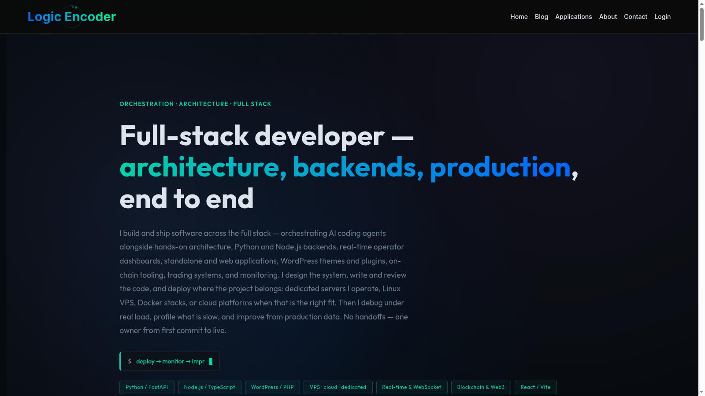

# Logic Encoder Enhanced — WordPress Theme

A site presenting applications, technical writing and member content needs those areas to feel connected. Logic Encoder Enhanced brings them into a consistent WordPress presentation, with a configurable visual style and dedicated browsing surfaces.

## Tech stack

| Layer | Technologies |
|---|---|
| Application | PHP, WordPress |
| Supporting technologies | HTML, CSS, JavaScript |

## Present a clear homepage

The homepage introduces the site's work and gives visitors routes into its applications and content. Typography, spacing and a consistent visual system help the material feel like one site rather than a collection of disconnected pages. The featured image illustrates that first impression.

## Browse applications

Catalogue surfaces help visitors discover software products and open their detail pages. Product presentation works alongside the site's shop integration, connecting the public explanation with the next step in the buying journey. It gives applications a more useful home than a simple link list.

## Read and explore articles

Blog layouts support browsing and reading the site's writing in the same visual language. Navigation helps readers move between articles and related areas. This keeps technical content and product discovery connected without forcing every page into the same layout.

## Support member areas

Account and access-related surfaces fit into the wider site presentation. Visitors can move between public content and the relevant member journey with a consistent interface. The theme works with the site's access plugins rather than presenting those flows as a separate visual experience.

## Adjust the site through WordPress

Customizer controls let the operator shape supported aspects of the presentation without manually rebuilding each page. Administrator integration and compatibility with the site's plugins support routine maintenance. Catalogue, article, account and Customizer screenshots would show more than the current homepage alone.

---

Private code: [logic-encoder-theme](https://github.com/logicencoder/logic-encoder-theme)

See [REPOS.md](REPOS.md) for related repositories.

**[Logic Encoder](https://logicencoder.com)** · [GitHub](https://github.com/logicencoder) · [Contact](https://logicencoder.com/contact/)
