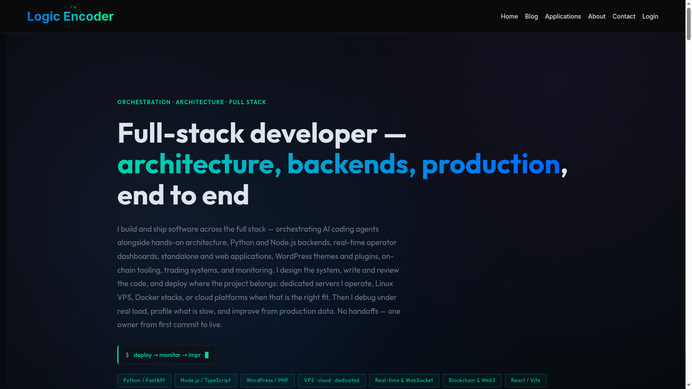

# Logic Encoder Enhanced — WordPress Theme

A WordPress site that presents software products, technical writing and member pages needs one visual system and one place to change it. Logic Encoder Enhanced is a custom theme for exactly that: a dark, technical design with a homepage built from editable sections, a manager for the application catalogue, page templates for the sign-in and account journey, and a long list of Customizer controls. It is built for a site owner who wants to change text, colours, fonts and layout from the WordPress Customizer instead of editing template files.

## Tech stack

| Layer | Technologies |
|---|---|
| Theme | PHP and WordPress template hierarchy with Customizer API settings |
| Front end | HTML, CSS and JavaScript, with effects that can be switched off |
| Administration | A custom application manager and custom list screens for pages and posts |
| Verification | Playwright end-to-end tests |

## Homepage

The front page is assembled from sections whose wording the owner edits in the Customizer: a hero with an eyebrow line, a description, an optional animated terminal that types out a list of lines, and a row of pills; then an approach block, a capabilities block, an applications teaser, a blog teaser with a configurable number of posts, a technology stack block, an about block and a closing call to action. Every section has its own label, title and subtitle fields, and the view-all links and button texts are editable too.

## Application catalogue

The App Manager adds an administration page for the application catalogue, with adding, editing, deleting and reordering done in place without page reloads. Each application has a title, description, tag, link, thumbnail, category, a type of Live, Beta or Standalone, and switches that decide whether it appears on the applications page, on the homepage or in the footer. The type sets the group heading, the badge and the button text, so a downloadable tool reads differently from a web app. The catalogue renders through one shortcode on the applications page and in the homepage teaser, with optional category filter chips and a configurable number of grid columns.

## Pages and templates

Dedicated templates cover the pages a product site needs: homepage, blog, about, contact, sign-in, forgot password, reset password, email verification, account, dashboard, single post, search results and a 404. The login template has a split layout and a centred one, with an editable brand title and subtitle, and the account page lets the owner choose how many columns its statistics and settings use. The blog shows an excerpt of a set number of words, and an optional reading-progress bar tracks position in a long article.

## Customizer controls

Appearance is controlled in one place: heading, body, navigation and logo fonts, a base font size, a colour preset, two border-radius sizes, content margins and the width of the homepage wrapper. Effects such as scroll reveal, the typewriter, the dot grid, the background animation, a back-to-top button and the reading progress can each be turned on or off. The footer brand, description, copyright, contact address and three link lists are editable, and the homepage title and description used for search results have their own fields.

## Member shortcodes

The theme registers shortcodes for content that depends on who is reading. Wrapping text in them shows it only to logged-in users, to administrators, to a chosen role or to a membership level of basic, premium or VIP, and visitors who do not qualify see a short message with a link to sign in. Further shortcodes print the signed-in user's account information, offer a logout button, and give administrators registration totals and consent counts. The theme reads the membership level from user data; granting levels and handling sign-in belongs to the site's membership tools.

## Administration

Pages and posts get a redesigned list screen that still uses WordPress's own queries, capability checks and trash handling, and the application manager sits in the same administration menu. A Playwright suite covers the homepage, the navigation fonts and the collapsible navigation, with visual-regression screenshots.

---

Private code: [logic-encoder-theme](https://github.com/logicencoder/logic-encoder-theme)

See [REPOS.md](REPOS.md) for related repositories.

**[Logic Encoder](https://logicencoder.com)** · [GitHub](https://github.com/logicencoder) · [Contact](https://logicencoder.com/contact/)
